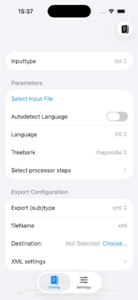

An all up parser

What I want: a button in an iOS app that will run an all-up ML pipeline to tokenise, POS tag, lemmatise, add morphological features, and add syntactic dependencies to a blob of text.
Why do all this ? To make a model that can run natively on iOS.

  

  The all-up parser taking a manually refined tokenisation, parsing and exporting to XML with, POS tags, lemmas, and dependency annotations.

