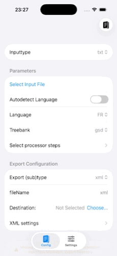

An all up parser

What I wanted: a button in an iOS app to run a pipeline to sentences, tokenise, POS tag, lemmatise, add morphological features, and add syntactic dependencies to text, then export to file.
Why do all this ? To learn a bit of Swift + SwiftUI while putting a bit of Py into the mix to train some models to do all the processing on-device.

The all-up parser taking a user-refined tokenisation of text (below left) or a file (below right), then parsing and exporting to XML with POS tags, lemmas, morphological feats and dependency annotations, all predicted on-device.

  
   &nbsp;&nbsp;
  

 

  
